# Kiến Trúc Quản Lý Kho & Vòng Đời Tồn Kho F&B: Định Lượng Món (BOM), Cân Bằng Kho & Đối Soát Chuỗi

> **One-liner:** Mô hình kiến trúc quản lý kho F&B chuẩn hóa từ dịch ngược KiotViet FnB kết hợp thực địa Nêm & Nếm: khấu trừ tự động theo công thức BOM, kiểm kho 3 trạng thái (Stocktake), tính giá vốn bình quân di động (MAC) và xử lý chênh lệch chuyển kho liên chi nhánh.

---

## Metadata
- **Source:** Dịch ngược hệ thống KiotViet FnB (326 HTML templates, OData API, `nemnemjsc`) + Vận hành thực địa Nêm & Nếm (`nemnem-admin`).
- **Author/Creator:** Đội ngũ Kỹ thuật Nêm & Nếm (@dungcq).
- **Captured Date:** 2026-11-05
- **Tags:** `#architecture` `#fnb-restaurant` `#inventory-management` `#stocktake` `#bom-recipe` `#moving-average-cost` `#inter-branch-transfer` `#kiotviet-fnb`
- **Category:** `architecture`

---

## 1. The Core Idea (Sự Thật Vận Hành Kho F&B Thực Địa)

Áp dụng quản lý kho sản xuất công nghiệp vào nhà hàng luôn thất bại vì những ngộ nhận kinh điển:

1. **Ảo tưởng "Trừ kho tức thời từng hạt tiêu, cọng hành khi nấu":**
   - Không đầu bếp nào vừa xào rau vừa bấm máy tính để trừ $5\,\text{g}$ muối hay $10\,\text{ml}$ dầu ăn.
   - Hệ thống F&B thực tế chỉ trừ kho nguyên vật liệu thô **khi và chỉ khi Hóa đơn bán hàng (Settled Invoice) được thanh toán thành công** thông qua Bảng định lượng nguyên vật liệu (**Bill of Materials - BOM**).
2. **Kho nhà hàng luôn có độ trễ và sai số tự nhiên (Organic Shrinkage):**
   - Thịt hao hụt rã đông, rau úng nước, gia vị bay hơi, đầu bếp nêm nếm thêm. Tồn kho lý thuyết trên phần mềm (`OnHand`) **luôn luôn lệch** so với thực tế trong tủ đông (`ActualCount`).
   - Do đó, **Kiểm kho định kỳ (Stocktake)** không phải là hoạt động trừng phạt, mà là công cụ sinh tồn để định kỳ **đồng bộ lại thực tế làm chuẩn gốc** (`OnHand := ActualCount`) và hạch toán số lệch vào chi phí hao hụt.
3. **Giá vốn biến động liên tục (Moving Average Cost - MAC):**
   - Khác với hàng bách hóa có giá niêm yết cố định, thực phẩm tươi sống biến thiên giá từng ngày theo phiên chợ. Giá vốn xuất kho bắt buộc phải tính theo phương pháp **Bình quân gia quyền di động** sau mỗi lần nhập hàng mới.

---

## 2. Key Mechanisms & Patterns (Cơ Chế Chi Tiết)

### A. Mô Hình Định Lượng Thành Phẩm (BOM & Processing Sector)
- **Món bán (Menu Item / Product):** Là thực thể xuất hiện trên thực đơn POS (`is_sale_item = 1`).
- **Nguyên vật liệu (Raw Material / Ingredient):** Là thực thể quản lý trong kho (`is_stock_item = 1`), theo dõi tồn kho và giá vốn.
- **Bảng định lượng (Recipe / BOM):** Mỗi món bán liên kết với 1 danh sách định lượng:
  $$\text{Deduction Qty}_i = \text{Sold Qty} \times \text{Recipe Ratio}_i \times (1 + \text{Waste Factor}_i)$$
  *(Trong đó `Waste Factor` là tỷ lệ hao hụt sơ chế tự nhiên, ví dụ: $1\,\text{kg}$ cá tươi sau khi làm sạch mang vây chỉ còn $0.8\,\text{kg}$ thịt fillet $\rightarrow$ Hao hụt 20%).*
- **Phân khu chế biến (Processing Sector):** Định tuyến món tự động trên màn hình Bếp / In nhiệt LAN: Bếp Nóng, Bếp Lạnh, Quầy Bar, Quầy Thu ngân.

### B. Vòng Đời Kiểm Kho 3 Trạng Thái (Stocktake Lifecycle)
1. **Phiếu tạm (Status = 0 - Draft):**
   - Nhân viên quét mã hoặc nhập số lượng đếm thực tế (`actual_count`).
   - Hệ thống tính toán độ lệch: $\text{difference} = \text{actual\_count} - \text{on\_hand}$.
   - **Bất biến:** Ở trạng thái Draft, tồn kho hệ thống **tuyệt đối không bị thay đổi**. Nhà hàng vẫn bán hàng bình thường.
2. **Cân bằng kho (Status = 1 - Balanced):**
   - Quản lý duyệt phiếu kiểm. Hệ thống thực hiện atomic transaction:
     * Cập nhật `on_hand := actual_count`.
     * Ghi một dòng vào Sổ kho (`stock_ledger` / `StockCard`) với loại giao dịch `ADJUSTMENT`.
     * Tính toán giá trị chênh lệch tài chính: $\text{Adjustment Value} = \text{difference} \times \text{cost\_price}$.
   - Khóa vĩnh viễn phiếu kiểm (Read-only).
3. **Đã hủy (Status = 2 - Cancelled):** Hủy bỏ đợt kiểm kho, không tác động dữ liệu.

### C. Công Thức Tính Giá Vốn Bình Quân Di Động (MAC - Moving Average Cost)
Khi hoàn tất 1 Đơn Nhập Hàng (`PurchaseOrder`, Status = 3):
$$\text{New Cost} = \frac{(\text{Current OnHand} \times \text{Current Cost}) + (\text{Inward Qty} \times \text{Inward Rate})}{\text{Current OnHand} + \text{Inward Qty}}$$
*Lưu ý bảo vệ:* Nếu $\text{Current OnHand} \le 0$ (kho đang bị âm do bán trước nhập sau), thì $\text{New Cost} = \text{Inward Rate}$.

### D. Vòng Đời Xuất Hủy / Hao Hụt (Damage Items)
- Ghi nhận hàng hỏng, ôi thiu, vỡ chai lọ, cháy khét.
- Trừ trực tiếp `on_hand`, ghi sổ kho loại `DAMAGE`, hạch toán giá trị hủy vào tài khoản chi phí quản lý vận hành.

### E. Chuyển Kho Liên Chi Nhánh (Inter-Branch Transfers)
Mô hình 2 pha (Two-Phase Commit) chống thất thoát trên đường vận chuyển:
1. Chi nhánh Gửi tạo phiếu Xuất chuyển (`Transfer Out`) $\rightarrow$ Trừ kho chi nhánh Gửi, hàng rơi vào trạng thái "Đang trung chuyển" (`In-Transit`).
2. Chi nhánh Nhận kiểm đếm thực tế và bấm Nhận (`Transfer In`):
   - Nếu đủ $\rightarrow$ Tăng kho chi nhánh Nhận.
   - Nếu thiếu/hỏng $\rightarrow$ Tách phần thiếu thành phiếu Xuất hủy vận chuyển (`In-Transit Damage`), không cho phép treo lơ lửng.

---

## 3. Real-World Production Cases (Các Tình Huống Thực Tế)

1. **Hiện tượng Bán Âm Kho (Negative Stock Anomaly):**
   - *Thực tế:* Nhà cung cấp chở $50\,\text{kg}$ thịt bò tới lúc 11h trưa. Bếp mang xào bán luôn cho khách. Đến 14h chiều Thu mua mới có thời gian mở máy nhập phiếu PO. Nếu hệ thống chặn không cho bán khi tồn kho $= 0$, thu ngân không thể in bill cho khách.
   - *Xử lý chuẩn:* Cho phép `on_hand` nhận giá trị âm tạm thời. Khi phiếu PO được duyệt vào lúc 14h, số lượng nhập sẽ tự động bù đắp phần âm và đưa tồn kho về dương mà không làm sai lệch sổ sách.
2. **Thay đổi công thức món giữa kỳ kinh doanh:**
   - *Thực tế:* Đầu bếp đổi công thức món Bò kho (tăng cà rốt từ $100\,\text{g} \rightarrow 150\,\text{g}$).
   - *Xử lý chuẩn:* BOM phải có phiên bản hoặc mốc thời gian (`effective_date`). Hóa đơn bán trước 10:00 sáng áp dụng định mức cũ; hóa đơn sau 10:00 sáng áp dụng định mức mới. Không cập nhật đè (overwrite) công thức cũ làm sai lệch lịch sử trừ kho.
3. **Đơn vị kép (Dual Unit of Measure):**
   - *Thực tế:* Mua bia theo Thùng ($24\,\text{lon}$), bán theo Lon; Mua dầu ăn theo Can ($5\,\text{lít}$), định lượng xào theo Mililit ($20\,\text{ml}$).
   - *Xử lý chuẩn:* Bắt buộc quy đổi về Đơn vị cơ sở nhỏ nhất (Base UOM) khi lưu kho (`ml`, `g`, `lon`) kết hợp hệ số quy đổi đóng gói (`conversion_factor`).

---

## 4. Reconstructability Blueprint (Bản Vẽ Tái Dựng Độc Lập)

### A. Authoritative Schema & Data Model (SQL DDL)
```sql
-- 1. Bảng nguyên vật liệu & hàng tồn kho
CREATE TABLE tabItem (
    item_code VARCHAR(50) PRIMARY KEY,
    item_name VARCHAR(255) NOT NULL,
    base_uom VARCHAR(20) NOT NULL,             -- Đơn vị cơ sở: g, ml, lon, qua
    is_stock_item TINYINT(1) DEFAULT 1,         -- Có quản lý tồn kho không
    is_sale_item TINYINT(1) DEFAULT 0,          -- Có bán trên thực đơn không
    on_hand DECIMAL(12, 4) DEFAULT 0.0000,      -- Số lượng tồn kho hiện tại
    cost_price BIGINT NOT NULL DEFAULT 0,       -- Giá vốn bình quân (VND, kiểu số nguyên)
    min_stock_level DECIMAL(12, 4) DEFAULT 0,   -- Tồn kho tối thiểu cảnh báo nhập
    created_at TIMESTAMP DEFAULT CURRENT_TIMESTAMP,
    updated_at TIMESTAMP DEFAULT CURRENT_TIMESTAMP ON UPDATE CURRENT_TIMESTAMP
);

-- 2. Bảng định lượng món (BOM Recipe)
CREATE TABLE tabItemBOM (
    id BIGINT AUTO_INCREMENT PRIMARY KEY,
    parent_item_code VARCHAR(50) NOT NULL,      -- Mã món bán (VD: BO_KHO)
    ingredient_item_code VARCHAR(50) NOT NULL,  -- Mã NVL tiêu hao (VD: THIT_BO)
    quantity DECIMAL(12, 4) NOT NULL,           -- Định lượng cần dùng
    uom VARCHAR(20) NOT NULL,                   -- Đơn vị định lượng (phải tương thích base_uom)
    waste_percentage DECIMAL(5, 2) DEFAULT 0,   -- Tỷ lệ hao hụt tự nhiên (%)
    FOREIGN KEY (parent_item_code) REFERENCES tabItem(item_code),
    FOREIGN KEY (ingredient_item_code) REFERENCES tabItem(item_code)
);

-- 3. Sổ kho bất biến (Immutable Stock Ledger)
CREATE TABLE tabStockLedger (
    id BIGINT AUTO_INCREMENT PRIMARY KEY,
    posting_date DATETIME NOT NULL,
    item_code VARCHAR(50) NOT NULL,
    voucher_type ENUM('INWARD', 'SALE_BOM', 'STOCKTAKE', 'DAMAGE', 'TRANSFER_OUT', 'TRANSFER_IN') NOT NULL,
    voucher_no VARCHAR(100) NOT NULL,
    actual_qty DECIMAL(12, 4) NOT NULL,         -- Dương = Nhập, Âm = Xuất
    incoming_rate BIGINT NOT NULL DEFAULT 0,    -- Giá nhập (nếu là Inward)
    balance_qty DECIMAL(12, 4) NOT NULL,        -- Số dư tồn sau giao dịch
    valuation_rate BIGINT NOT NULL DEFAULT 0,   -- Giá vốn tại thời điểm giao dịch
    branch_id VARCHAR(50) NOT NULL DEFAULT 'main',
    FOREIGN KEY (item_code) REFERENCES tabItem(item_code),
    INDEX idx_item_date (item_code, posting_date)
);

-- 4. Phiếu kiểm kho (Stocktake Header & Items)
CREATE TABLE tabStocktake (
    stocktake_id VARCHAR(50) PRIMARY KEY,       -- VD: ST-2026-0012
    branch_id VARCHAR(50) NOT NULL,
    status TINYINT NOT NULL DEFAULT 0,          -- 0: Draft, 1: Balanced, 2: Cancelled
    total_difference_value BIGINT DEFAULT 0,    -- Tổng giá trị chênh lệch (VND)
    created_by VARCHAR(100) NOT NULL,
    balanced_by VARCHAR(100),
    balanced_at DATETIME
);

CREATE TABLE tabStocktakeItem (
    id BIGINT AUTO_INCREMENT PRIMARY KEY,
    stocktake_id VARCHAR(50) NOT NULL,
    item_code VARCHAR(50) NOT NULL,
    on_hand DECIMAL(12, 4) NOT NULL,            -- Tồn lý thuyết lúc mở phiếu
    actual_count DECIMAL(12, 4) NOT NULL,       -- Số lượng kiểm đếm thực tế
    difference DECIMAL(12, 4) NOT NULL,         -- actual_count - on_hand
    cost_price BIGINT NOT NULL,                 -- Giá vốn tại thời điểm kiểm
    difference_value BIGINT NOT NULL,           -- difference * cost_price
    FOREIGN KEY (stocktake_id) REFERENCES tabStocktake(stocktake_id) ON DELETE CASCADE,
    FOREIGN KEY (item_code) REFERENCES tabItem(item_code)
);
```

### B. Core State Machines & Guards (Mermaid)

```mermaid
stateDiagram-v2
    [*] --> Stocktake_Draft : Tạo phiếu kiểm kê (Status = 0)
    
    Stocktake_Draft --> Stocktake_Draft : Quét barcode / Đếm hàng thực tế\n(Cập nhật actual_count, difference)
    
    Stocktake_Draft --> Stocktake_Balanced : Bấm [Cân bằng kho] (Status = 1)\n[Guard: Phải có quyền Quản lý/Kế toán]\n[Action: on_hand = actual_count; ghi Sổ kho ADJUSTMENT]
    
    Stocktake_Draft --> Stocktake_Cancelled : Bấm [Hủy phiếu] (Status = 2)\n[Action: Không đổi tồn kho]
    
    Stocktake_Balanced --> [*] : Khóa vĩnh viễn (Read-Only)
    Stocktake_Cancelled --> [*]
```



### C. Core Algorithms (TypeScript / Go Blueprint)

```typescript
// 1. Tính toán giá vốn bình quân di động (Moving Average Cost)
export function calculateMovingAverageCost(
  currentOnHand: number,
  currentCost: bigint,
  inwardQty: number,
  inwardRate: bigint
): bigint {
  if (inwardQty <= 0) return currentCost;
  // Nếu kho đang âm hoặc bằng 0, lấy ngay giá nhập mới làm giá vốn
  if (currentOnHand <= 0) return inwardRate;

  const currentTotal = BigInt(Math.round(currentOnHand * 1000)) * currentCost;
  const inwardTotal = BigInt(Math.round(inwardQty * 1000)) * inwardRate;
  const newTotalQty = BigInt(Math.round((currentOnHand + inwardQty) * 1000));

  return (currentTotal + inwardTotal) / newTotalQty;
}

// 2. Tự động bóc tách trừ kho nguyên vật liệu khi thanh toán hóa đơn
export interface RecipeLine {
  ingredientCode: string;
  qtyPerPortion: number;
  wastePercentage: number;
}

export function deductBOMForSettledInvoice(
  soldQty: number,
  recipe: RecipeLine[]
): Array<{ itemCode: string; deductQty: number }> {
  return recipe.map((r) => {
    const rawUsage = soldQty * r.qtyPerPortion;
    const totalDeduct = rawUsage * (1 + r.wastePercentage / 100);
    return {
      itemCode: r.ingredientCode,
      deductQty: Number(totalDeduct.toFixed(4)),
    };
  });
}
```

---

## 5. Related Links & Notes
- Liên kết chéo: [Vận Hành Mua Hàng & Thanh Toán Nhà Hàng P2P](fnb-restaurant-p2p-procurement-and-settlement.md)
- Liên kết chéo: [Quản Lý Vòng Đời Tạm Tính POS & Stale Drift](fnb-pos-pre-bill-lifecycle-and-stale-drift-detection.md)
- Liên kết chéo: [Dịch Ngược SaaS Internal API & Bypassing Constraints](../agentic-workflows/reverse-engineering-saas-api-bypassing-immutable-constraints.md)
